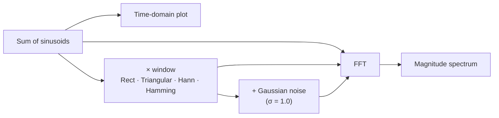

<div align="center">

# 📡 Telecommunication Signal Processing

**Fourier analysis, frequency-domain analysis and window functions, explored in Python.**


</div>

---

## Overview

A digital signal processing (DSP) project covering:

| Concept | Where |
|---|---|
| **Frequency-domain analysis** with the Fast Fourier Transform (FFT) | both scripts |
| **Signal composition** from multiple frequency components | `telecommunication_1.py` |
| **Window functions** and their effect on spectral analysis | `telecommunication_2.py` |
| **Noise analysis** in signal processing | `telecommunication_2.py` |



## `telecommunication_1.py`: three frequency scenarios

Each scenario builds a composite signal and analyses it in the time domain and the frequency domain.

| Scenario | Frequencies | Shows |
|---|---|---|
| **1 · Low frequency** | 2, 4, 6, 10, 16, 26, 42, 68, 110 Hz | Signal composition and FFT of low-frequency components |
| **2 · Mid-frequency dominant** | 50–700 Hz | Mid-range content with varying amplitudes |
| **3 · High-frequency dominant** | 1000–2400 Hz | High-frequency signal characteristics |

## `telecommunication_2.py`: window functions

| Window | Notes |
|---|---|
| **Rectangular** | No windowing; baseline for spectral leakage |
| **Triangular** | Linear taper |
| **Hann** | Raised cosine, tapers to zero at both ends |
| **Hamming** | Raised cosine that doesn't reach zero; lower first sidelobe |

For each window the script:

1. Plots the window over the signal in the time domain
2. Runs the FFT on the windowed signal
3. Adds Gaussian noise and repeats the FFT, to compare how each window holds up

## Run it

<details>
<summary><b>Requirements and usage</b></summary>

<br>

- Python 3.x
- NumPy
- SciPy
- Matplotlib

```bash
pip install numpy scipy matplotlib
python telecommunication_1.py
python telecommunication_2.py
```

Each script opens its plots in Matplotlib windows.

</details>

---

<div align="center">

**Pradyumna Shetty** · [LinkedIn](https://www.linkedin.com/in/pradyumna-shetty-534a14132/) · [Portfolio](https://portfolio-gamma-teal-22.vercel.app)

</div>
